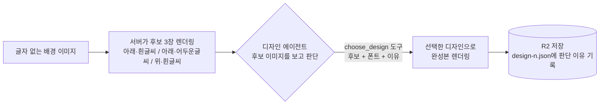
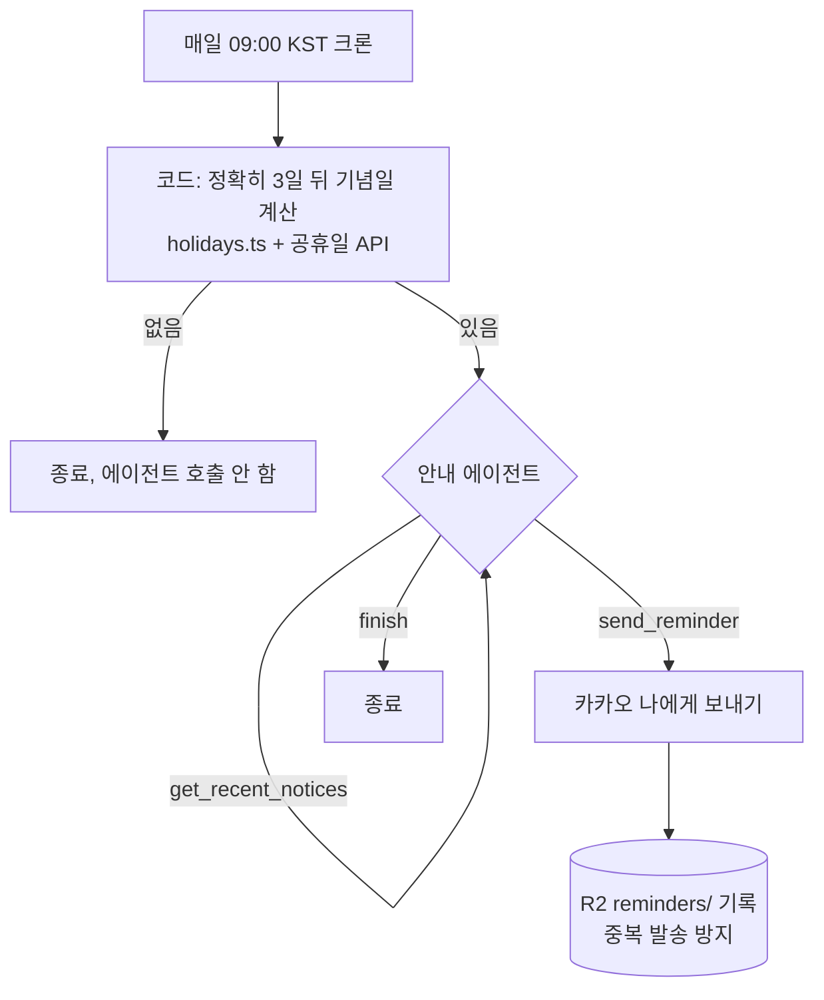
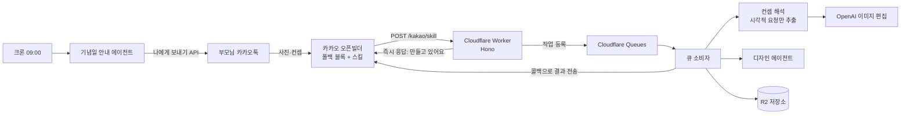

# 마운틴독 비서: 애견카페 AI 공지 에이전트

컴퓨터에 익숙하지 않은 부모님이 운영하는 애견카페를 위해 만든 **카카오톡 AI 비서**입니다.
카톡으로 강아지 사진과 원하는 컨셉을 보내면 SNS에 올릴 공지 이미지를 만들어 주고,
기념일이 다가오면 먼저 "공지를 만들어 두세요"라고 알려 줍니다.

> 직접 써 보기: 카카오톡에서 **마운틴독 비서** 채널을 추가하세요. ([채널 바로가기](http://pf.kakao.com/_QfJxeX))
> 사용법: **[테스트 가이드 페이지 (휴대폰용)](https://dog-cafe-assistant.thigma1201.workers.dev/guide)** 또는 아래 [테스트 가이드](#테스트-가이드)

## 테스트 가이드

누구나 카카오톡만 있으면 써 볼 수 있습니다. 비용 때문에 **1인당 하루 5번**(만들기·고치기 합계)까지 쓸 수 있습니다.

휴대폰에서는 QR 코드와 예시 문장 복사 버튼이 있는 [테스트 가이드 페이지](https://dog-cafe-assistant.thigma1201.workers.dev/guide)가 더 편합니다.

### 따라 하기
1. **채널 추가**: 카카오톡에서 `마운틴독 비서`를 검색하거나 [채널 바로가기](http://pf.kakao.com/_QfJxeX)를 연다.
2. **강아지 사진 보내기**: 얼굴만 나온 사진도 괜찮다. 단, **원본 전송은 끄고** 일반 화질로 보낸다(아이폰 HEIC 원본은 처리하지 못함).
3. **컨셉과 "공지 문구" 적기**: 원하는 변화는 편하게 적고, 이미지에 넣을 글자는 **따옴표 안에** 적는다.
   ```
   크리스마스 컨셉으로 산타 모자를 씌우고 배경을 바꿔줘, 공지는 "크리스마스 당일에도 오픈합니다"
   ```
   - 따옴표를 두 번 쓰면 두 번째는 작은 안내 문구가 된다.
   - 따옴표 없이 보내면 문구를 한 번 더 묻고, "문구 없이"를 누르면 글자 없는 이미지를 만든다.
4. **30초~1분 기다리기**: "만들고 있어요… (오늘 테스트 1/5번째)" 안내 뒤 시안이 도착한다.
5. **말로 고치기**: 시안을 보고 바꾸고 싶은 점을 그대로 보낸다. (예: `모자를 초록색으로 바꿔줘`)
6. **마무리**: `좋아요`를 누르면 끝. `다른 컨셉으로`를 누르면 같은 사진·같은 문구로 컨셉만 바꿔 다시 만든다(새 컨셉만 적으면 됨, 문구도 바꾸려면 따옴표로 함께 적기). 다른 사진으로 하려면 새 사진을 보내면 처음부터 시작한다.

### 보내 볼 예시
| 시험할 것 | 사진 다음에 보낼 문장 |
|---|---|
| 기념일 공지 | `크리스마스 컨셉으로 산타 모자를 씌우고 배경을 바꿔줘, 공지는 "크리스마스 당일에도 오픈합니다"` |
| 그림체 바꾸기 | `만화 그림체로 바꾸고 배경은 꽃밭으로 해줘, 공지는 "봄맞이 산책 이벤트"` |
| 제목 + 안내 문구 | `할로윈 컨셉으로 마녀 모자를 씌워줘, 공지는 "해피 할로윈" 그리고 "31일은 오후 6시까지 운영합니다"` |
| 영업 안내 | `깔끔한 카페 배경으로 바꿔줘, 공지는 "12월 25일 휴무 안내"` |
| 글자 없이 | `눈 내리는 겨울 배경으로 바꿔줘` → `문구 없이` |

### 확인해 볼 점
- **강아지가 그대로인지**: 생김새가 바뀌거나, 얼굴 사진인데 몸을 지어내지 않는지
- **한글이 정확한지**: 따옴표 안 문구가 틀린 글자 없이 들어갔는지
- **디자인 에이전트의 판단**: 글자가 강아지를 가리지 않고 잘 읽히는지, 컨셉에 맞는 폰트(둥근/굵은)를 골랐는지
- **말로 고치기**: 요청한 부분만 바뀌고 나머지는 유지되는지

### 잘 안 될 때
| 증상 | 해결 |
|---|---|
| 1분이 지나도 이미지가 안 옴 | 이미지 생성이 1분을 넘긴 경우. 같은 문장을 다시 보낸다 |
| "오늘 테스트 횟수를 다 썼어요" | 하루 5번 제한. 다음 날 다시 시도한다 |
| "이 사진 형식은 쓸 수 없어요" | 원본 전송 사진. 원본을 끄고 다시 보낸다 |
| 아무 반응이 없음 | 채팅방이 **상담 연결** 상태면 챗봇이 답하지 않는다. 채팅방 위쪽이나 메뉴에서 **상담 종료**를 누른 뒤 다시 보낸다 |
| 상담 종료 후에도 반응이 없음 | 채널 추가 직후 몇 분 걸릴 수 있다. 사진을 다시 보내거나 채팅방을 나갔다 다시 들어온다 |

> 기념일 안내(3일 전 알림)는 사장님 계정에만 연결되는 기능이라 테스터는 직접 받아 볼 수 없습니다. 동작 방식은 [3-2. 기념일 안내 에이전트](#3-2-기념일-안내-에이전트-srcreminderts)를 참고하세요.

---

## 1. 해결하려는 문제

| 문제 | 해결 |
|---|---|
| 부모님은 앱 설치나 웹사이트 사용이 어렵다 | 매일 쓰는 **카카오톡** 하나로 모든 기능을 제공 |
| 기념일 공지 이미지를 매번 디자이너처럼 만들기 어렵다 | 사진 + 말 한마디로 시안 생성, 말로 수정 |
| AI 이미지 모델은 한글을 자주 틀리게 그린다 | 이미지는 AI가, **한글 글자는 코드가** 정확하게 얹음 |
| 공지를 만들어야 할 날을 잊는다 | 기념일 3일 전에 **에이전트가 먼저 안내** |

## 2. 주요 기능

### 2-1. 카톡으로 공지 이미지 만들기
1. 챗봇에 강아지 사진을 보낸다.
2. 원하는 컨셉을 말로 적고, 이미지에 넣을 문구는 **따옴표 안에** 적는다.
   - 예) `크리스마스 컨셉으로 산타 모자를 씌우고 배경을 바꿔줘, 공지는 "크리스마스 당일에도 오픈합니다"`
   - 따옴표를 두 번 쓰면 두 번째는 작은 안내 문구가 된다.
3. 30초~1분 뒤 시안이 도착한다. 마음에 안 들면 말로 고친다. (예: "모자를 초록색으로")
4. "좋아요"를 누르면 끝. 이미지를 길게 눌러 저장해 인스타·네이버에 올린다.
5. "다른 컨셉으로"를 누르면 같은 사진과 문구로 컨셉만 바꿔 다시 만든다.

### 2-2. 기념일 3일 전 안내
- 매일 오전 9시, 3일 뒤가 기념일이면 부모님 카톡 **나와의 채팅**으로 안내와 예시 문장을 보낸다.
- 안내 메시지의 "챗봇 열기" 버튼으로 바로 공지를 만들 수 있다.

## 3. 에이전트 구성

이 프로젝트에는 **역할이 다른 AI 두 가지**가 함께 일합니다.

| 역할 | 담당 | 하는 일 |
|---|---|---|
| 이미지 생성 모델 | OpenAI `gpt-image-2` | 강아지 사진을 컨셉에 맞게 편집 (구도·강아지 생김새 유지) |
| **디자인 에이전트** | OpenAI `gpt-5-mini` + 도구 | 생성된 이미지를 **직접 보고** 글자 위치·색·폰트를 판단 |
| **기념일 안내 에이전트** | OpenAI `gpt-5-mini` + 도구 | 기록을 조회해 **안내할지 판단**하고 안내 문장을 써서 발송 |

### 3-1. 디자인 에이전트 (`src/designer.ts`)
"생성 모델은 만들고, 에이전트는 보고 판단해 다듬는다"는 구조입니다.



- 판단 기준: 글자가 강아지 얼굴·몸을 가리지 않는가, 배경과 대비가 충분한가, 컨셉 분위기에 맞는 폰트인가
- 제목 폰트: 둥근 폰트(배민 주아) / 굵은 폰트(배민 도현) 중 선택
- 판단 이유(`reason`)는 R2의 `notices/{id}/design-{n}.json`에 남아 나중에 확인할 수 있다.
- 실패하거나 시간이 초과되면 기본 디자인으로 대신해 공지 생성은 항상 성공한다.

### 3-2. 기념일 안내 에이전트 (`src/reminder.ts`)
날짜 계산은 코드가 정확하게, 판단과 문장은 에이전트가 맡습니다.



| 도구 | 설명 |
|---|---|
| `get_reminder_history` | 올해 이미 보낸 안내 목록 |
| `get_recent_notices` | 최근 두 달간 만든 공지(컨셉·제목) |
| `send_reminder` | 안내 문장을 카톡으로 발송 (180자 이내, 예시 문장 포함) |
| `finish` | 판단 요약을 남기고 종료 |

- 기념일 분류(`src/holidays.ts`)
  - **꼭 안내(must)**: 신정, 어린이날, 크리스마스, 연말, 설날·추석 등 공휴일. 에이전트가 빠뜨리면 코드가 기본 문장으로 대신 보낸다.
  - **에이전트 판단(judge)**: 국제 강아지의 날(3/23), 반려동물의 날(4/11), 세계 개의 날(8/26), 세계 동물의 날(10/4), 할로윈, 개의 날(11/1)
- 사실(영업시간·이벤트)을 지어내지 않도록 지시하고, 사장님만 아는 내용은 "OO시"로 비워 둔다.

## 4. 전체 구조



- **콜백 + 큐**: 카카오 스킬은 5초 안에 답해야 하므로 먼저 "만들고 있어요"라고 답하고, 실제 작업은 큐 소비자가 처리한 뒤 콜백으로 결과를 보낸다(콜백 한도 1분).
- **한글 글자 합성**: resvg-wasm으로 SVG를 렌더링해 정확한 한글을 얹고 인스타 피드 비율(1080×1350, 4:5)로 자른다.
- **저장소(R2)**: 원본·배경·완성 이미지, 사용자 대화 상태, 카카오 토큰, 안내 기록

### 기술 스택
Cloudflare Workers · Hono · Cloudflare Queues · R2 · Cron Triggers · resvg-wasm · OpenAI Images API / Responses API · 카카오 i 오픈빌더 · 카카오 로그인 / 나에게 보내기 API

### 파일 구조
| 파일 | 역할 |
|---|---|
| `src/index.ts` | 라우팅, 크론·큐 핸들러 연결 |
| `src/kakao.ts` | 카카오 스킬: 대화 흐름, 상태 관리, 큐 등록·처리, 테스트 사용량 제한 |
| `src/concept.ts` | 메시지를 컨셉과 따옴표 속 공지 문구로 분리 |
| `src/notices.ts` | 공지 생성·수정 (이미지 생성 → 디자인 에이전트 → 저장) |
| `src/openai.ts` | OpenAI 이미지 편집 API 호출 |
| `src/visualConcept.ts` | 사장님 말에서 시각적 요청(옷·소품·배경·그림체)만 뽑아 영어로 바꿈 |
| `src/prompts.ts` | 이미지 프롬프트 (원본 구도 유지, 글씨 금지 규칙 포함) |
| `src/designer.ts` | 디자인 에이전트 |
| `src/overlay.ts` | 한글 글자 합성과 4:5 자르기 |
| `src/fonts.ts` | 폰트 불러오기 (Pretendard, R2의 제목 폰트) |
| `src/reminder.ts` | 기념일 안내 에이전트 |
| `src/holidays.ts` | 기념일 목록 (이 파일만 고치면 날짜 추가·삭제) |
| `src/kakaoMemo.ts` | 카카오 로그인 연결, 토큰 갱신, 나에게 보내기 |
| `src/page.ts` | 개발용 웹 테스트 화면 (카톡과 같은 흐름: 컨셉 + 제목) |
| `src/guide.ts` | 테스터용 사용 안내 페이지 (`/guide`) |

## 5. 개선 과정

| 문제 | 원인 | 해결 |
|---|---|---|
| AI가 한글을 엉터리로 그림 | 이미지 모델의 한글 렌더링 한계 | 이미지에는 글자를 넣지 않고 코드로 합성 |
| 카톡에서 이미지가 가끔 안 옴 | `waitUntil`의 30초 제한에 작업이 끊김 | Cloudflare Queues로 옮겨 콜백 한도(1분)까지 사용 |
| 큐 소비자가 CPU 한도 초과 | 글자 합성(렌더링)이 CPU를 많이 씀 | Workers Paid + `cpu_ms` 상향, 미리보기는 작게 렌더링 |
| 디자인 에이전트가 늘 기본 폰트만 선택 | "추천 폰트: basic" 입력과 치우친 지시문 | 추천값 제거, 폰트 선택 기준을 지시문에 명시, 선택지를 두 폰트로 제한 |
| 디자인 에이전트 호출이 느림 | "그려 보고 → 다시 확인" 2회 호출 | 후보 3장을 미리 그려 한 번에 비교·선택 |
| 지시 문장이 칠판 글씨로 그려짐 ("수요일에 일하고 목요일에 쉰다고 해줘") | 사장님 말 원문을 이미지 모델에 그대로 넘김 | 생성 전에 작은 모델이 시각적 요청만 뽑아 넘기고(`visualConcept.ts`), 글씨 있는 물체 금지 규칙 추가 |
| 기념일 목록이 장면을 고정 | 기념일마다 장면·폰트가 미리 정해져 있었음 | 기념일 목록을 없애고 웹·카톡 모두 자유 컨셉 입력으로 통일 |
| 얼굴 사진인데 몸 전체를 지어냄 | "전신이 가운데 오게", "아래 30% 비우기", 세로 크기 고정 | 원본 구도 유지 규칙 추가, 출력 크기 `auto` |
| 안내 문장이 사실을 지어냄 ("간식 제공") | 지시문에 금지 규칙 없음 | 사실 지어내기 금지, 사장님만 아는 내용은 "OO시"로 비우기 |

## 6. 직접 배포하기

### 준비물
- Cloudflare 계정 (Workers **Paid** 플랜: Queues 소비자의 CPU 시간 때문에 필요)
- OpenAI API 키
- 카카오톡 채널 + 카카오 i 오픈빌더 챗봇
- (기념일 안내) Kakao Developers 앱
- (선택) 공공데이터포털 "한국천문연구원 특일 정보" API 키

### 설치와 로컬 실행
```bash
npm install
cp .dev.vars.example .dev.vars   # 값 채우기
npm run dev                      # http://localhost:8787 (웹 테스트 화면)
```

### Cloudflare 리소스와 secret
```bash
npx wrangler r2 bucket create dog-cafe-assistant
npx wrangler queues create dog-cafe-jobs
npx wrangler secret put OPENAI_API_KEY
npx wrangler secret put ADMIN_TOKEN              # 웹 테스트 화면·관리 API용 (긴 무작위 값 권장)
npx wrangler secret put KAKAO_SKILL_SECRET       # 오픈빌더 스킬 헤더 X-Skill-Secret과 같은 값
npx wrangler secret put KAKAO_ALLOWED_USER_IDS   # 제한 없이 쓸 사용자 ID, 쉼표로 구분
npx wrangler secret put KAKAO_REST_API_KEY       # 기념일 안내용
npx wrangler secret put KAKAO_CLIENT_SECRET      # 카카오 앱에서 클라이언트 시크릿을 켠 경우
npx wrangler secret put REMINDER_INVITE_CODE     # 기념일 안내 연결 링크의 초대 코드
npx wrangler secret put SPCDE_API_KEY            # (선택) 설날·추석 등 공휴일
npm run deploy
```

### 주요 설정 (`wrangler.jsonc`의 `vars`)
| 이름 | 설명 |
|---|---|
| `OPENAI_IMAGE_MODEL` | 이미지 편집 모델 (`gpt-image-2`) |
| `OPENAI_DESIGN_MODEL` | 디자인·안내 에이전트 모델 (`gpt-5-mini`) |
| `STORE_NAME` | 이미지 하단에 표시할 가게 이름 (비우면 표시 안 함) |
| `PUBLIC_ORIGIN` | 이 Worker 주소 (카카오 로그인 Redirect URI, 메시지 링크) |
| `KAKAO_CHANNEL_CHAT_URL` | 안내 메시지 "챗봇 열기" 버튼이 여는 채널 채팅방 |
| `KAKAO_OPEN_TEST` | `"true"`면 허용 목록에 없는 사람도 하루 제한 안에서 사용 (심사·테스트용) |
| `KAKAO_TEST_DAILY_LIMIT` | 테스트 사용자 1명의 하루 생성·수정 횟수 |
| `REMINDER_DRY_RUN` | `"true"`면 안내를 실제로 보내지 않고 로그만 남김 |

### 카카오 설정 요약
- **오픈빌더**: 폴백 블록에 스킬 연결(`https://<worker>/kakao/skill`, 헤더 `X-Skill-Secret`), 스킬데이터 사용, **Callback 사용**(콜백 대기 메시지에 `{{#webhook.text}}`를 넣으면 서버가 보낸 안내와 테스트 사용 횟수가 표시됨), 운영 채널 연결 후 배포
- **Kakao Developers**: 카카오 로그인 ON, REST API 키의 리다이렉트 URI에 `https://<worker>/kakao/oauth/callback`, 동의항목 "카카오톡 메시지 전송" 선택 동의, Web 사이트 도메인 등록
- 부모님 기념일 안내 연결: `https://<worker>/kakao/oauth/start?invite=<초대코드>`를 부모님 휴대폰에서 열기

### 제목 폰트
공식 배포처에서 받은 TTF/OTF를 R2에 확장자 없이 올립니다. 폰트 파일은 저장소에 올리지 않고(`.gitignore`), 외부에도 공개되지 않습니다.
```bash
npx wrangler r2 object put dog-cafe-assistant/fonts/rounded --file ./fonts/BMJUA_otf.otf --remote
npx wrangler r2 object put dog-cafe-assistant/fonts/bold --file ./fonts/BMDOHYEON_otf.otf --remote
```

### 관리용 API
| 경로 | 설명 |
|---|---|
| `GET /` | 웹 테스트 화면 (관리자 토큰 필요) |
| `GET /guide` | 테스터용 사용 안내 페이지 (누구나 열람, `src/guide.ts`) |
| `POST /api/reminders/run` | 기념일 안내 에이전트 즉시 실행. `today=YYYY-MM-DD`로 날짜 가정, `dryRun=on/off` |
| `npx wrangler tail --format pretty` | 실시간 로그 (`designer`, `job done`, `reminder result` 등) |

## 7. 비용과 한계
- 비용은 대부분 OpenAI 이미지 생성(시안 1장당)에서 나옵니다. 품질은 결과물과 비용·속도의 균형을 위해 `medium`으로 설정되어 있습니다(`src/openai.ts`).
- 디자인·안내 에이전트는 작은 모델(`gpt-5-mini`)과 저해상도 이미지 입력을 써서 비용이 작습니다.
- 카톡 콜백 한도가 1분이라 이미지 생성이 길어지면 결과가 오지 않을 수 있습니다.
- 카톡 "원본 전송"(HEIC) 사진은 지원하지 않습니다. 일반 전송으로 보내야 합니다.
- 기념일 안내는 카카오 "나에게 보내기"를 쓰므로 받는 사람이 한 번 카카오 로그인으로 연결해야 합니다.
  (비즈니스 인증 후에는 챗봇 이벤트 API로 챗봇 채팅방에 직접 보내도록 바꿀 수 있습니다.)
